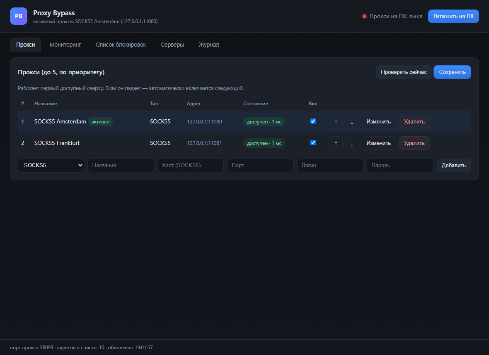
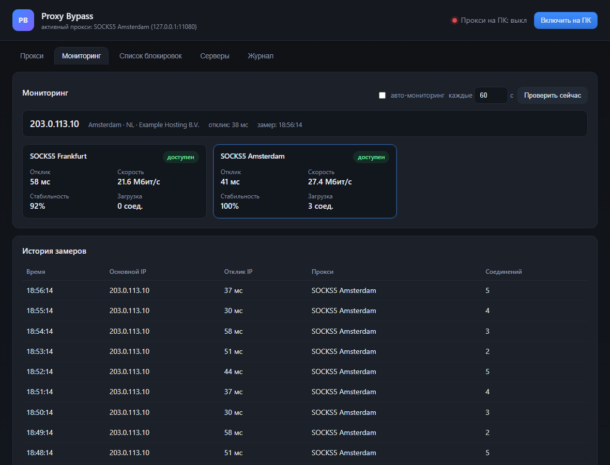
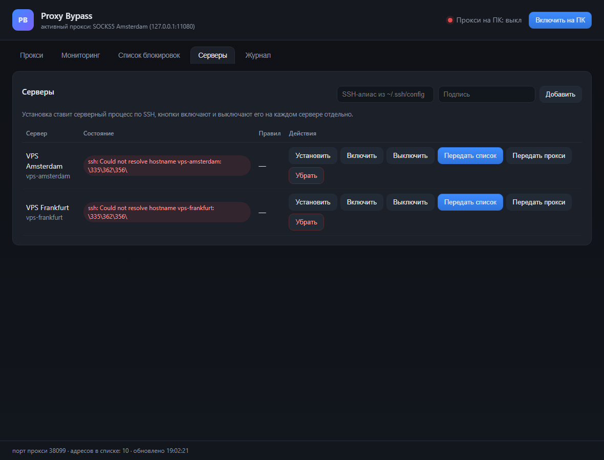
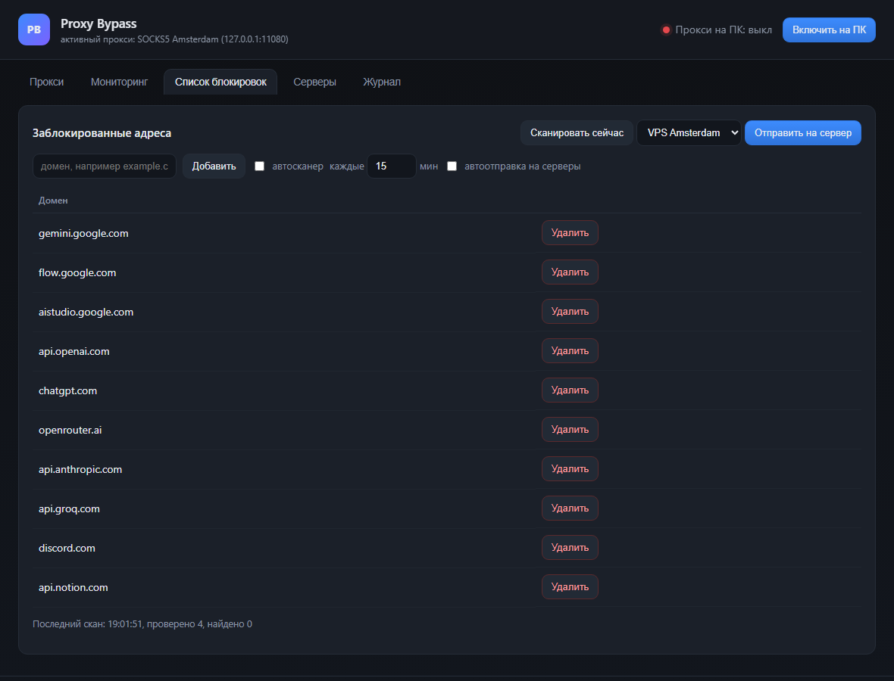

# Proxy Bypass

**Selective proxy bypass, controlled from a Windows PC.**

Proxy Bypass keeps a local routing proxy on the workstation, decides per host whether it must
leave through one of your SOCKS5 proxies, and manages the same bypass on your Linux servers over
SSH. Only the resources that are actually blocked go through a proxy; everything else keeps using
the normal connection.

> Version **0.1.0** — first public release. Windows 11 (Windows 10 works too).
> [Русская документация](README.ru.md)

## Screenshots

| Proxies and failover | Monitoring |
| --- | --- |
|  |  |

| Server fleet | Blocked-host list |
| --- | --- |
|  |  |

*(Screenshots are rendered with demo data: placeholder addresses and TEST-NET IPs.)*

## Why

Blocking is rarely total: a site may open its front page while the API behind it answers
"unsupported country", or a provider may silently drop a service at random. Whitelists rot, VPNs
send everything through a single foreign exit, and every workstation and server ends up configured
by hand.

Proxy Bypass is built around measurements instead:

- hosts are probed directly and through a proxy, and only the difference decides the route;
- one list of blocked hosts lives on the PC and is pushed to any number of servers;
- proxies are ordered and health-checked, so a dead proxy is skipped automatically;
- the PC is the control centre — servers never become the workstation's exit node.

## Features

| Area | What you get |
| --- | --- |
| **Proxies** | Up to 5 SOCKS5 proxies, priority order, health checks every 20 s, automatic failover to the next healthy proxy, add/edit/delete/enable in the UI. |
| **PC routing** | One toggle enables the Windows system proxy pointing at the local router; disabling restores the previous settings exactly. |
| **Blocked list** | One shared list of domains; manual add/remove; one click pushes it to any server, where it becomes iptables rules via the server daemon. |
| **Scanner** | Periodic direct-vs-proxy probing adds resources blocked on the main IP to the list automatically. |
| **Servers** | Add by SSH alias, install/update the Linux daemon, start/stop it per server, push the blocked list, push proxy credentials (rewrites `redsocks` upstream with a timestamped backup). |
| **Monitoring** | Continuous sampling of the main external IP and of every proxy: latency, download speed, stability over the last samples, current connection load, plus history. |
| **Autostart** | Installer puts the app into `%LOCALAPPDATA%\ProxyApp`, adds Start-menu and Startup shortcuts; a second launch just reopens the window. |

## How it works

```
                +-----------------------------------------------+
  Windows apps  |  Windows system proxy  127.0.0.1:38080        |
  and browser   +-----------------------+-----------------------+
                                        |
                              +---------v----------+
                              |  local router      |  per-host decision
                              |  (app/core/        |
                              |   local-proxy.mjs) |
                              +----+----------+----+
                                   |          |
                     blocked host  |          |  everything else
                                   v          v
                          +------------+   direct connection
                          | SOCKS5     |
                          | failover   |
                          | (up to 5)  |
                          +-----+------+
                                |
                                v
                     proxy exit / target resource

  control plane (never user traffic):
  PC app  --ssh-->  Linux servers  --redsocks-->  same SOCKS5 providers
```

1. `app/server.mjs` starts the router, the failover manager, the scanner, the monitor and the UI
   service (`127.0.0.1:8077`).
2. The router parses every request, looks up the host in the learned verdicts and sends it through
   the active proxy only when needed. Loopback, private ranges and always-direct hosts are never
   proxied. Unknown hosts go direct immediately and are classified in the background.
3. The SOCKS5 client is a single incremental parser handling IPv4, IPv6 and domain address types,
   with no per-step listener juggling (that race used to stall handshakes for seconds).
4. The monitor samples `ipinfo.io` directly for the main IP, and for each proxy measures SOCKS
   handshake latency plus a real HTTPS download (`speed.cloudflare.com`) for throughput.
5. Server management is plain `ssh` + `sudo -n`. The daemon (`assets/proxy-bypass.py`) keeps
   separate iptables chains, probes with `SO_MARK`, and routes only measured-blocked destinations.
   Pushing proxy credentials rewrites `/etc/redsocks.conf` with a timestamped backup and restarts
   `redsocks`; credentials are sent over SSH stdin, never on the command line.

## Quick start (Windows 11)

Requirements: Node.js 20+, OpenSSH client with `~/.ssh/config` aliases, a SOCKS5 proxy.

```cmd
git clone https://github.com/storyartpro/proxy-bypass.git
cd proxy-bypass
start.cmd
```

The window opens; the app listens on `127.0.0.1:8077` and the routing proxy on `127.0.0.1:38080`.

Install with autostart (no admin rights needed):

```powershell
powershell -ExecutionPolicy Bypass -File install.ps1
```

Silent launcher: `proxy-app.vbs`.

## Configuration

Settings live in `data/config.json` (the `data/` directory is ignored by git and contains local
secrets). The UI edits the same values.

```jsonc
{
  "port": 38080,                     // local routing proxy port
  "proxies": [                       // up to 5, order = priority
    { "id": "proxy-1", "name": "SOCKS5 proxy", "type": "socks5",
      "host": "10.0.0.1", "port": 1080, "login": "user", "password": "secret", "enabled": true }
  ],
  "blocked": ["gemini.google.com"], // shared blocked-host list
  "servers": [{ "alias": "my-server", "label": "My Linux server" }],
  "scanner":  { "enabled": true, "intervalMin": 15, "seeds": ["api.openai.com"] },
  "monitoring": { "enabled": true, "intervalSec": 60, "historyLimit": 180 },
  "autoPushToServers": false
}
```

## Security notes

- Proxy passwords are encrypted with Windows DPAPI for the current Windows account
  (`passwordEnc` in `data/config.json`). A copied config file is useless on another machine or
  account. The `data/` directory is ignored by git.
- Server credentials are never printed and are sent to servers over SSH stdin only.
- The UI and routing proxy listen on loopback only (`127.0.0.1`).
- The Windows system proxy is restored from a saved snapshot on disable.

## Repository layout

```
app/server.mjs            HTTP API, orchestration, startup
app/core/local-proxy.mjs  routing proxy + SOCKS5 client
app/core/upstreams.mjs    proxy pool, health checks, failover
app/core/servers.mjs      SSH install/control, blocked list and proxy push
app/core/monitor.mjs      IP/proxy monitoring
app/core/store.mjs        configuration and state
app/ui/                   web interface (HTML/CSS/JS)
app/assets/               Linux daemon sources copied to servers
docs/                     architecture, Windows setup, server guide
test/                     unit tests for the SOCKS5 client
install.ps1               installer with autostart
proxy-app.vbs             silent launcher
```

## Roadmap

- single-file `.exe` build (currently Node.js is required)
- multiple server groups and per-server proxy selection
- protocol support beyond SOCKS5 (HTTP CONNECT upstream)

## License

MIT — see [LICENSE](LICENSE).

## Authors

- **Storyart** — product owner, infrastructure, testing.
- **DeepSeek Harness agent** — implementation and documentation (AI assistant).

See [CHANGELOG.md](CHANGELOG.md) for release history.
