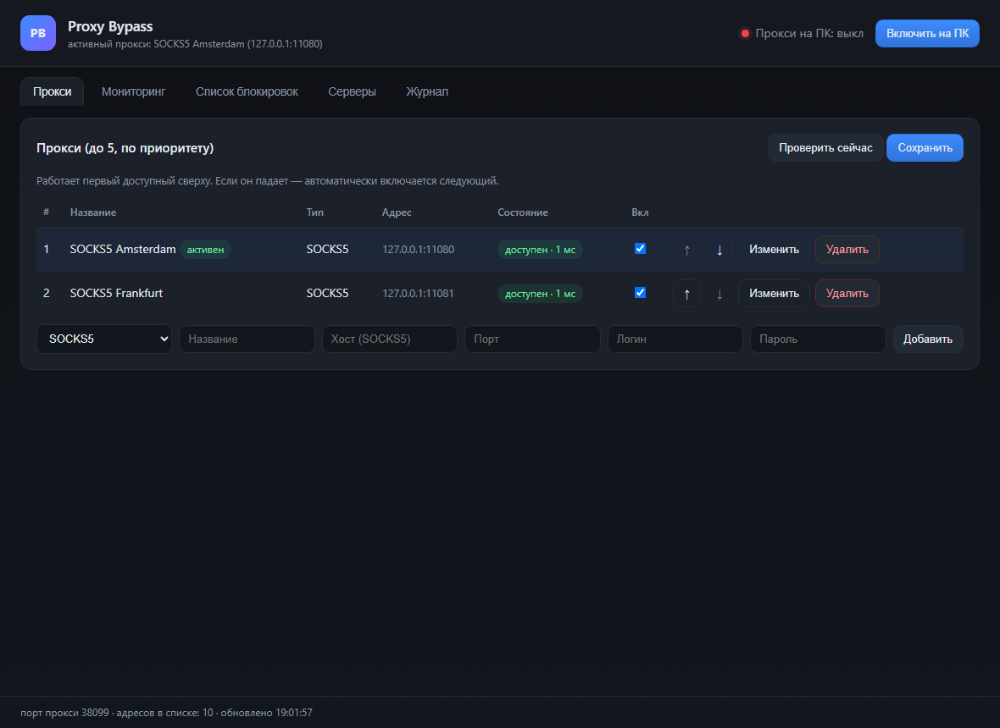
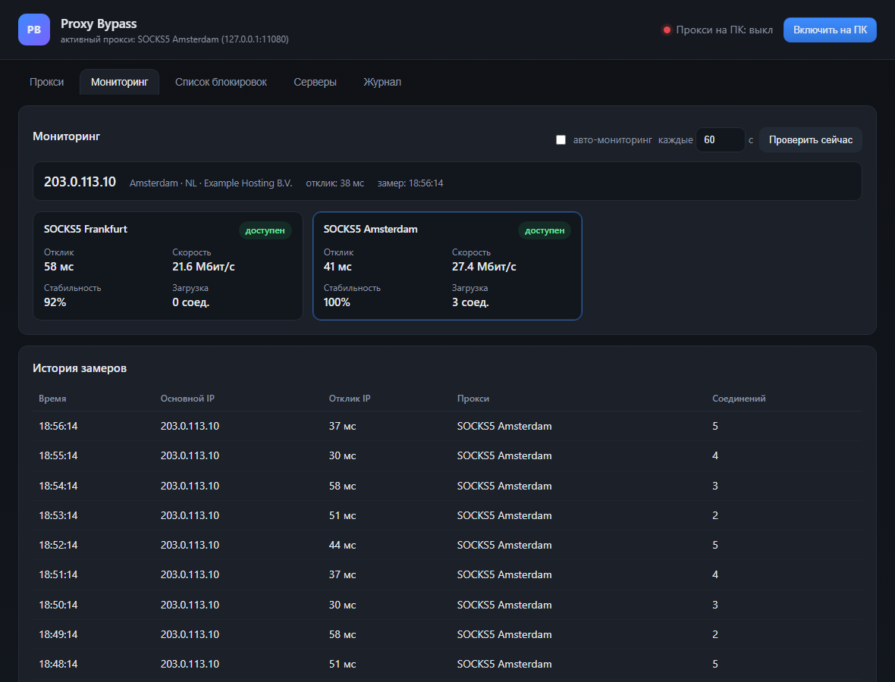
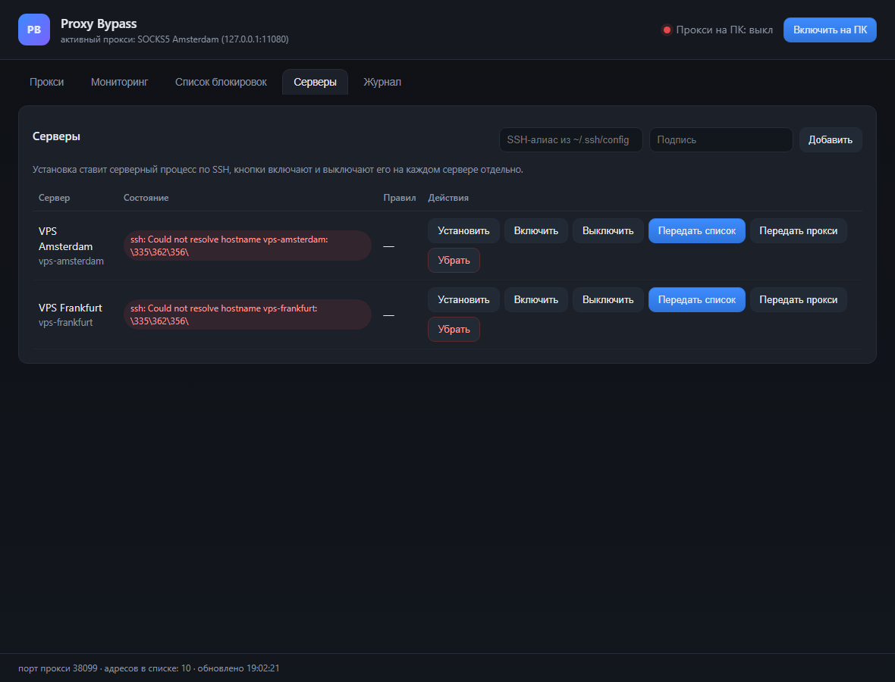
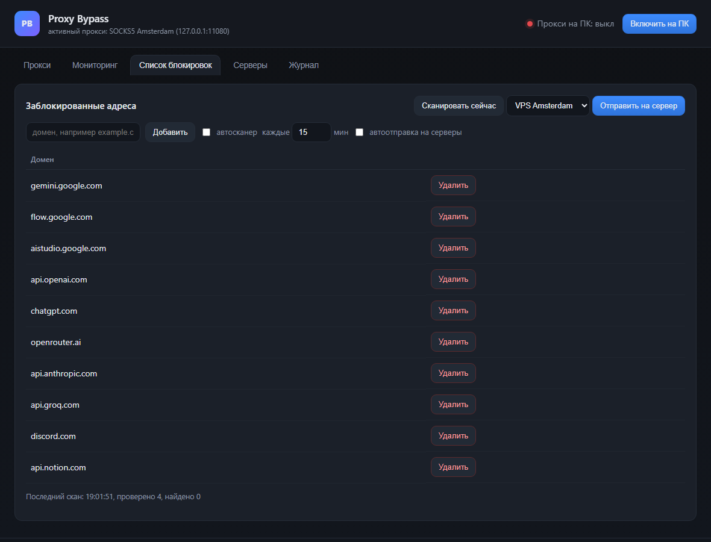

# Proxy Bypass

**Избирательный обход блокировок с управлением с Windows-ПК.**

Приложение держит на рабочей станции локальный маршрутизирующий прокси, решает для каждого
хоста, нужно ли выпускать его через один из ваших SOCKS5-прокси, и управляет таким же обходом
на Linux-серверах по SSH. Через прокси идёт только то, что действительно заблокировано,
остальной трафик остаётся обычным.

> Версия **0.1.2** — текущий релиз. Windows 11 (на Windows 10 тоже работает).
> [English documentation](README.md)

## Скриншоты

| Прокси и failover | Мониторинг |
| --- | --- |
|  |  |

| Серверы | Список блокировок |
| --- | --- |
|  |  |

*(Скриншоты сняты на демо-данных: адреса-заглушки и TEST-NET IP.)*

## Зачем

Блокировки редко бывают полными: страница открывается, а API за ней отвечает «unsupported
country»; провайдер молча режет отдельный сервис; списки обхода устаревают, а VPN гонит весь
трафик через один зарубежный выход. В итоге ПК и каждый сервер настраиваются вручную.

Proxy Bypass строится вокруг измерений:

- хост проверяется напрямую и через прокси — маршрут определяет разница результатов;
- единый список заблокированных адресов живёт на ПК и передаётся на любое число серверов;
- прокси упорядочены и проверяются на доступность, мёртвый пропускается автоматически;
- ПК — центр управления, серверы никогда не становятся его выходным узлом.

## Возможности

| Область | Что даёт |
| --- | --- |
| **Прокси** | До 5 SOCKS5-прокси, порядок по приоритету, проверка каждые 20 с, автоматическое переключение на следующий доступный, добавление/правка/удаление/включение в интерфейсе. |
| **Маршрут на ПК** | Одна кнопка включает системный прокси Windows на локальный маршрутизатор; выключение возвращает прежние настройки. |
| **Список блокировок** | Единый список доменов, IPv4-адресов и подсетей CIDR: одиночное добавление, **массовый импорт** (вставка списков через запятую/точку с запятой/табы/строки, таблиц Excel, ссылок) и **разворот домена** — определение его IP и всех поддомены с добавлением всего в список; отправка на любой сервер одной кнопкой (там он становится правилами iptables; IP-адреса маршрутизируются без DNS). |
| **Автосканер** | Периодическая проверка «напрямую против прокси» сама добавляет в список то, что блокируется по основному IP. |
| **Серверы** | Добавление по SSH-алиасу, установка/обновление демона, включение/выключение на каждом сервере, передача списка блокировок, передача реквизитов прокси (перезапись upstream в `redsocks` с резервной копией). |
| **Мониторинг** | Постоянные замеры основного внешнего IP и каждого прокси: отклик, скорость скачивания, стабильность, текущая загрузка соединений и история. |
| **Автозапуск** | Установщик кладёт приложение в `%LOCALAPPDATA%\ProxyApp`, добавляет ярлыки в «Пуск» и «Автозагрузку»; повторный запуск просто открывает окно. |
| **Туннель для приложений** | Необязательный локальный SOCKS5-туннель (`ssh -N -D 127.0.0.1:1081`), который приложение держит живым для программ, умеющих только собственный прокси — например, Telegram. |
| **Окно и трей** | Закрытие окна оставляет приложение работать в области уведомлений; меню в трее открывает окно, переключает прокси на ПК и содержит «Закрыть полностью» — остановить все компоненты, вернуть настройки Windows и выйти. |

## Как это работает

```
                +-----------------------------------------------+
  приложения    |  системный прокси Windows  127.0.0.1:38080    |
  и браузер     +-----------------------+-----------------------+
                                        |
                              +---------v----------+
                              |  локальный         |  решение по каждому хосту
                              |  маршрутизатор     |
                              +----+----------+----+
                                   |          |
                   заблокирован    |          |  всё остальное
                                   v          v
                          +------------+   напрямую
                          | SOCKS5     |
                          | failover   |
                          | до 5 прокси|
                          +-----+------+
                                |
                                v
                     выход прокси / целевой ресурс

  управляющий канал (не пользовательский трафик):
  ПК  --ssh-->  Linux-серверы  --redsocks-->  те же SOCKS5-провайдеры
```

1. `app/server.mjs` поднимает маршрутизатор, менеджер прокси, сканер, монитор и веб-интерфейс
   (`127.0.0.1:8077`).
2. Маршрутизатор для каждого запроса смотрит вердикт по хосту и отправляет через активный прокси
   только нужное. Loopback, приватные диапазоны и «всегда напрямую» не проксируются. Неизвестные
   хосты сразу идут напрямую, классификация выполняется в фоне.
3. SOCKS5-клиент — единый инкрементальный парсер, поддерживает IPv4, IPv6 и доменные адреса.
4. Монитор замеряет `ipinfo.io` напрямую для основного IP, а для каждого прокси — задержку
   SOCKS-рукопожатия и реальную скорость скачивания по HTTPS.
5. Управление серверами — обычные `ssh` и `sudo -n`. Демон `assets/proxy-bypass.py` держит
   отдельные цепочки iptables, проверяет адреса с `SO_MARK` и заворачивает только измеренно
   заблокированное. Передача реквизитов перезаписывает `/etc/redsocks.conf` с резервной копией и
   перезапускает `redsocks`; реквизиты идут через stdin SSH, а не в командной строке.

## Быстрый старт (Windows 11)

Требования: Node.js 20+, клиент OpenSSH с алиасами в `~/.ssh/config`, SOCKS5-прокси.

```cmd
git clone https://github.com/storyartpro/proxy-bypass.git
cd proxy-bypass
start.cmd
```

Откроется окно; интерфейс на `127.0.0.1:8077`, маршрутизатор на `127.0.0.1:38080`.

Установка с автозапуском (без прав администратора):

```powershell
powershell -ExecutionPolicy Bypass -File install.ps1
```

Тихий запуск без консоли — `proxy-app.vbs`.

## Настройка

Настройки лежат в `data/config.json` (каталог `data/` игнорируется git и содержит локальные
секреты). Интерфейс правит те же значения.

```jsonc
{
  "port": 38080,                     // порт локального маршрутизатора
  "proxies": [                       // до 5, порядок = приоритет
    { "id": "proxy-1", "name": "SOCKS5", "type": "socks5",
      "host": "10.0.0.1", "port": 1080, "login": "user", "password": "secret", "enabled": true }
  ],
  "blocked": ["gemini.google.com"], // общий список блокировок
  "servers": [{ "alias": "my-server", "label": "Мой сервер" }],
  "scanner":  { "enabled": true, "intervalMin": 15, "seeds": ["api.openai.com"] },
  "monitoring": { "enabled": true, "intervalSec": 60, "historyLimit": 180 },
  "autoPushToServers": false
}
```

## Безопасность

- Пароли прокси шифруются через Windows DPAPI для текущей учётной записи (поле `passwordEnc` в
  `data/config.json`). Скопированный конфиг бесполезен на другом компьютере или под другой учёткой.
  Каталог `data/` исключён из репозитория.
- Реквизиты серверов не печатаются и отправляются только через stdin SSH.
- Интерфейс и маршрутизатор слушают только loopback (`127.0.0.1`).
- При выключении системный прокси Windows восстанавливается из сохранённого снимка.

## Состав репозитория

```
app/server.mjs            HTTP API, оркестрация, запуск
app/core/local-proxy.mjs  маршрутизирующий прокси и SOCKS5-клиент
app/core/upstreams.mjs    пул прокси, проверки, failover
app/core/servers.mjs      SSH: установка/управление, передача списка и прокси
app/core/monitor.mjs      мониторинг IP и прокси
app/core/store.mjs        конфигурация и состояние
app/ui/                   веб-интерфейс (HTML/CSS/JS)
app/assets/               исходники Linux-демона для серверов
docs/                     архитектура, установка на Windows, руководство по серверам
test/                     тесты SOCKS5-клиента
install.ps1               установщик с автозапуском
proxy-app.vbs             тихий запуск
```

## План развития

- сборка в один `.exe` (сейчас нужен Node.js);
- группы серверов и выбор прокси для каждого сервера;
- поддержка HTTP CONNECT как upstream.

## Лицензия

MIT — см. [LICENSE](LICENSE).

## Авторы

- **Storyart** — постановка задачи, инфраструктура, тестирование.
- **DeepSeek Harness agent** — реализация и документация (ИИ-ассистент).

История релизов — [CHANGELOG.md](CHANGELOG.md).
