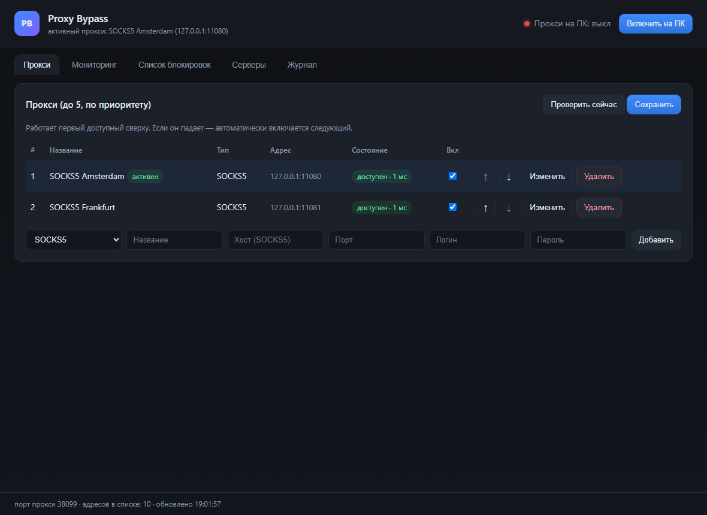
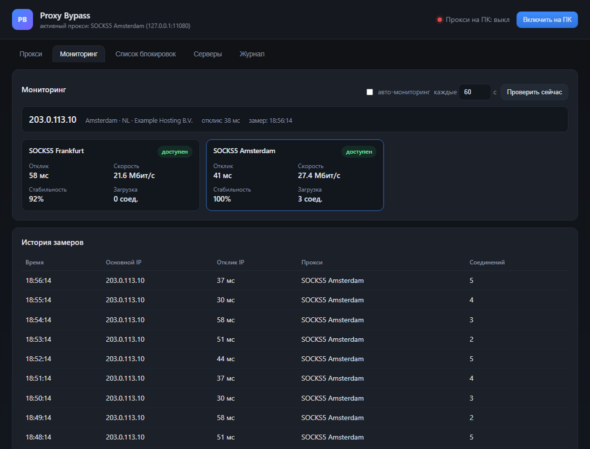

# Proxy Bypass

Selective proxy bypass controlled from a Windows 11 PC: only resources that are actually blocked
go through one of your SOCKS5 proxies, everything else keeps the normal connection.

**Version 0.1.0** · [GitHub repository](https://github.com/storyartpro/proxy-bypass) ·
[Releases](https://github.com/storyartpro/proxy-bypass/releases)

## Start here

- [Quick start and features (English)](https://github.com/storyartpro/proxy-bypass/blob/main/README.md)
- [Быстрый старт и возможности (русский)](https://github.com/storyartpro/proxy-bypass/blob/main/README.ru.md)
- [Windows setup](https://github.com/storyartpro/proxy-bypass/blob/main/docs/WINDOWS-SETUP.md)
- [Linux servers](https://github.com/storyartpro/proxy-bypass/blob/main/docs/SERVERS.md)
- [Architecture](https://github.com/storyartpro/proxy-bypass/blob/main/docs/ARCHITECTURE.md)
- [Changelog](https://github.com/storyartpro/proxy-bypass/blob/main/CHANGELOG.md)

## What it does

- up to five SOCKS5 proxies in priority order with automatic failover;
- one toggle for the Windows system proxy, with exact restore on disable;
- a shared blocked-host list pushed to any Linux server over SSH;
- an automatic scanner that adds resources blocked on the main IP;
- monitoring of the main IP and of every proxy: latency, speed, stability, load;
- server fleet management: install, start, stop, push the list, push proxy credentials.

## Install

```cmd
git clone https://github.com/storyartpro/proxy-bypass.git
cd proxy-bypass
start.cmd
```

With autostart:

```powershell
powershell -ExecutionPolicy Bypass -File install.ps1
```

## Screenshots





## License and authors

MIT. Built by **Storyart** and the **DeepSeek Harness agent**.
